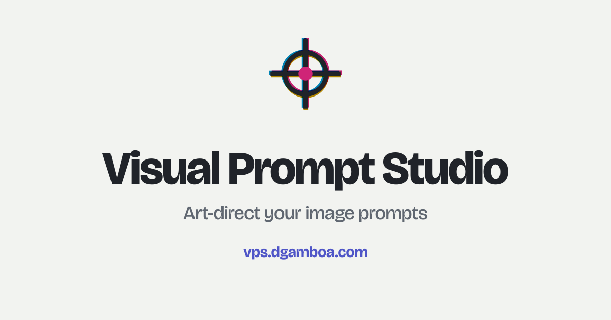
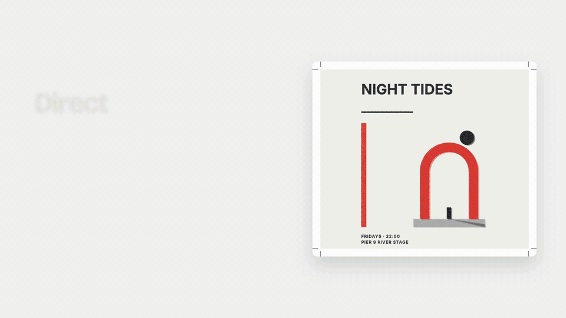
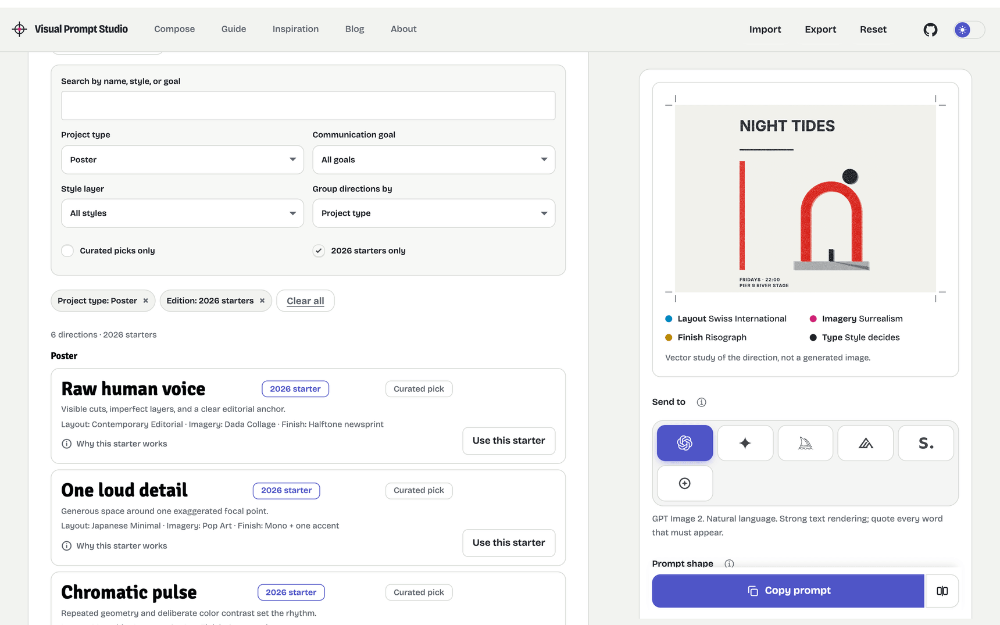
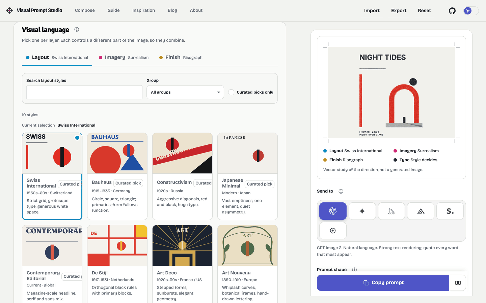
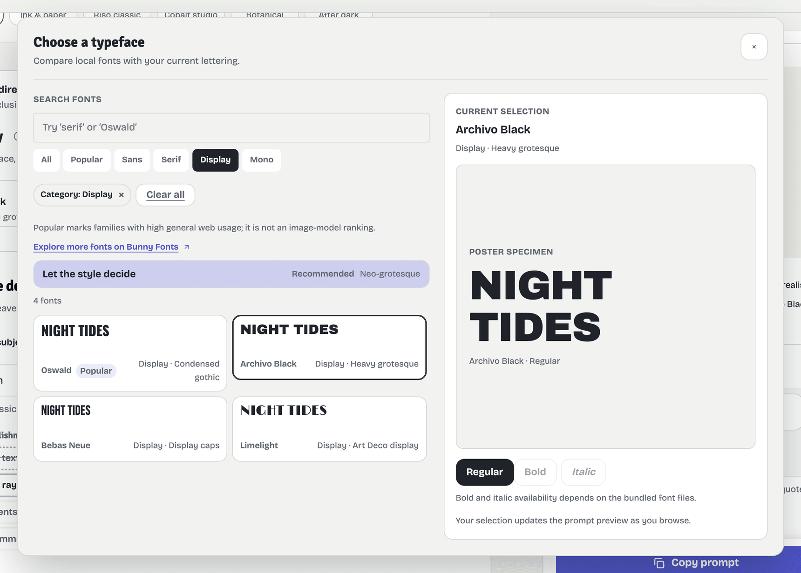
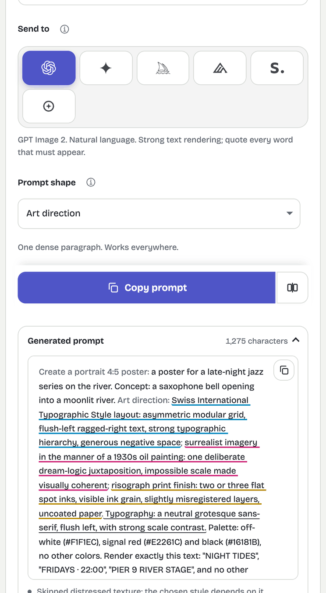

<p align="center">
  
</p>

<h1 align="center">Visual Prompt Studio</h1>

<p align="center">
  Art-direct your image prompts. Compose a layout, imagery and print finish, add your exact text, and copy a prompt tuned to the image model you use.
  <br>
  Local-first. Copy-first. No accounts, no server, no generation.
</p>

<p align="center">
  <a href="https://github.com/difegam/visual-prompt-studio/actions/workflows/quality.yml"></a>
  <a href="LICENSE"></a>
  
  
</p>

<p align="center">
  <a href="https://vps.dgamboa.com">Live demo</a> ·
  <a href="#why-visual-prompt-studio">Why</a> ·
  <a href="#features">Features</a> ·
  <a href="#quick-start">Quick start</a> ·
  <a href="docs/README.md">Docs</a> ·
  <a href="#development">Development</a> ·
  <a href="CONTRIBUTING.md">Contributing</a>
</p>

<p align="center">
  
</p>

## Why Visual Prompt Studio

Most people ask an image model for "a poster for my event" and get something generic. The fix is art direction: say what the layout is, how the picture is drawn, and what the print finish looks like, then say what to avoid. Visual Prompt Studio turns those choices into a prompt you can paste into your image tool.

- **Layered art direction.** Layout, imagery and finish are chosen independently, so you combine them instead of picking one flat style name.
- **Model-aware output.** The prompt structure changes with the target: ChatGPT Images, Gemini, Midjourney, FLUX, Stable Diffusion or any other model.
- **Your exact words.** Keep poster text exactly as written, or reserve a clean area to typeset later.
- **Local-first, copy-first.** The app makes no API calls and sends no recipe data anywhere. It does not generate images.
- **Starting points with reasons.** Six 2026 starter directions each explain a design principle, a tradeoff and link to their sources.

## Features

### Start from a direction

Tell the Studio what you are making (poster, flyer, book cover, album cover, social post, story cover, editorial illustration or event banner) and the goal. It recommends matching directions. Open the explorer to search and filter all 16 directions, including a "2026 starters only" filter. Applying a starter changes only the visual choices, keeps your brief and text, and can be undone.

<p align="center">
  
</p>

### Three independent style layers

Pick **Layout** (grid, hierarchy, where the type sits), **Imagery** (the art movement or visual language) and **Finish** (the print or material treatment) from a 29-entry catalog. A vector proof sheet previews the combination. It is a study of the direction, not a generated image.

<p align="center">
  
</p>

### Palettes, typography and the font picker

Choose from six palettes and 14 bundled typefaces. The font picker has search, category filters, a live specimen, and weight and italic toggles. The model receives a description of the type's character, not the font file.

<p align="center">
  
</p>

### Exact text and exclusions

Enter a headline and up to four more lines. Choose whether the model should render the text or leave clean space. Pick from 19 exclusions, and see common clichés for your subject category. Exclusions that conflict with your chosen style are flagged and skipped automatically. An optional authorial-intent field adds a point of view: concept, material, variation or restraint.

### Prompts tuned to the target

| Target           | What changes                                                                    |
| ---------------- | ------------------------------------------------------------------------------- |
| ChatGPT Images   | Natural language. Every word that must appear is quoted.                        |
| Gemini           | Natural language, like briefing a designer. Refine in the same chat.            |
| Midjourney       | A descriptive phrase plus parameters such as `--ar`, `--no`, `--sref`, `--raw`. |
| FLUX             | No negative prompt. Exclusions are rewritten as what you want instead.          |
| Stable Diffusion | Separate positive and negative prompts, with a "Copy negative" action.          |
| Other model      | Plain natural language with constraints stated in words.                        |

Each target offers the prompt shapes that suit it: Art direction (concise), Seven-line brief, Production spec, Point-of-view brief, Restyle in same chat, and Edit with reference. Prompts can be written in English or Spanish.

<p align="center">
  
</p>

### Copy actions and comparison

Copy the prompt, copy the negative prompt when the target supports one, or compare your directed prompt with an undirected one to see what art direction adds.

### Recipes stay on your device

Your recipe is saved in the browser. Export it as JSON and import it later. Imports and stored data pass the same schema validation, and unreadable stored data is backed up rather than discarded.

### Also included

A written [user guide](https://vps.dgamboa.com/guide), a filterable list of inspiration links, a blog and About page, light and dark themes, and search.

## Quick start

You need the Node.js version in [`.nvmrc`](.nvmrc) (22.23.4 or newer, an even-numbered release) and [pnpm](https://pnpm.io) 11.17.0.

```sh
git clone https://github.com/difegam/visual-prompt-studio.git
cd visual-prompt-studio
pnpm install --frozen-lockfile
pnpm dev
```

Open <http://localhost:4321>.

## Development

| Command               | What it does                                                            |
| --------------------- | ----------------------------------------------------------------------- |
| `pnpm dev`            | Starts the dev server with theme and search-index generation.           |
| `pnpm lint`           | Runs ESLint over `src/` and `scripts/`.                                 |
| `pnpm format:check`   | Checks Prettier formatting.                                             |
| `pnpm check`          | Refreshes the search index and runs `astro check`.                      |
| `pnpm test:discovery` | Runs the prompt-compiler and discovery tests.                           |
| `pnpm build`          | Production build, then validates routes, canonicals, alt text and more. |
| `pnpm build:preview`  | The same build in noindex preview mode.                                 |

| Path                            | What it holds                                   |
| ------------------------------- | ----------------------------------------------- |
| `src/pages/index.astro`         | The Studio (`/`)                                |
| `src/pages/guide.astro`         | The user guide                                  |
| `src/lib/prompt-studio/domain/` | Typed data and the prompt compiler              |
| `src/lib/prompt-studio/ui/`     | Browser-side app, sketch preview and Studio CSS |
| `src/layouts/components/`       | `PromptStudio` and the `Studio*` components     |
| `src/content/`                  | Blog posts, authors and the About page          |

More in the [documentation](docs/README.md):
[getting started](docs/getting-started.md) ·
[features](docs/features.md) ·
[architecture](docs/architecture.md) ·
[adding a target](docs/adding-a-target.md) ·
[content authoring](docs/content-authoring.md) ·
[design principles](docs/design-principles.md) ·
[deployment](docs/deployment.md) ·
[git hooks](docs/git-hooks.md) ·
[glossary](docs/glossary.md)

Working with an AI coding agent? [`AGENTS.md`](AGENTS.md) holds the project instructions and the Astro docs MCP setup.

## Where it started

The seven-line prompt structure and the layered view of style come from two Spanish-language resources:

- Video: [Deja de generar imágenes genéricas con ChatGPT](https://www.youtube.com/watch?v=FX8c_ytLuIQ)
- Post: [Crear imágenes con ChatGPT: estilos, prompts y ejemplos](https://beailabs.beehiiv.com/p/crear-imagenes-chatgpt), by Beatriz Ruiz García (beailabs)

The style catalog's names and categories derive from John Hartnup's [Poster Prompts](https://john.hartnup.uk/poster-prompts); the descriptions are original. The site's About page and blog post tell the story in more detail.

## Contributing

Issues and pull requests are welcome. Read [CONTRIBUTING.md](CONTRIBUTING.md) first, and follow the [Code of Conduct](CODE_OF_CONDUCT.md). Report security problems as described in [SECURITY.md](SECURITY.md).

## License

Apache License 2.0. See [LICENSE](LICENSE). The project began as a derivative of [Astroplate](https://github.com/zeon-studio/astroplate) by Zeon Studio (MIT); that notice is kept in [NOTICE](NOTICE). Review third-party package licenses and any assets you add before distributing a derived site.
